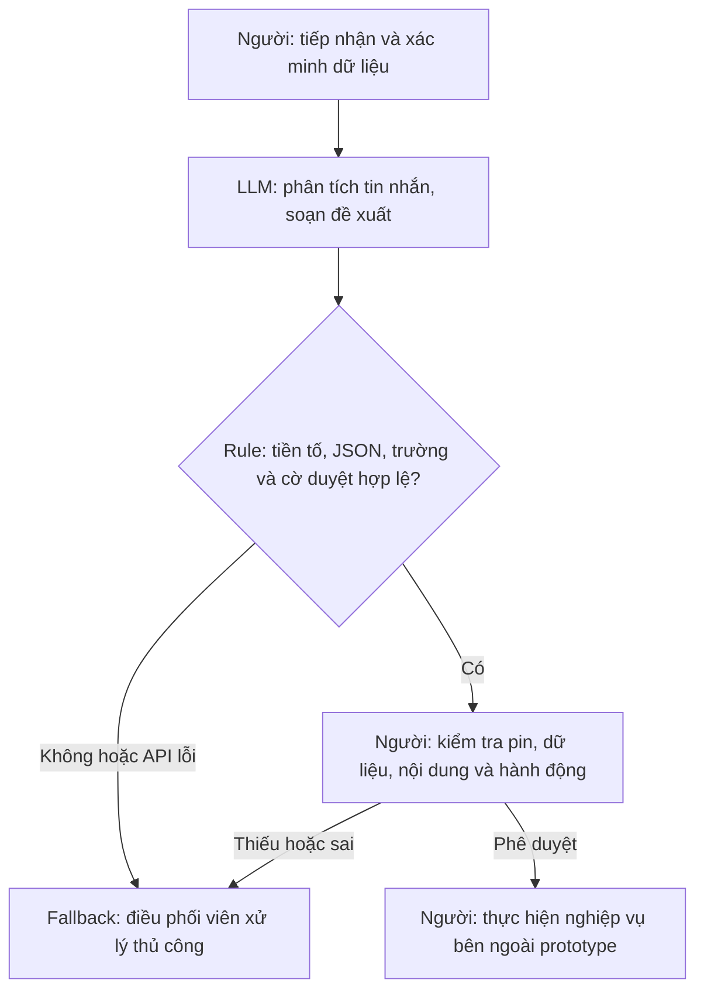

# Lab 02 — Trợ lý xử lý sự cố pin Xanh SM

## 1. Phạm vi và bằng chứng

Đây là tình huống **mô phỏng phục vụ học tập**. Không có khảo sát hiện trường, dữ liệu nội bộ, phỏng vấn stakeholder hay số đo thật. Các con số là giả định minh họa và mục tiêu thử nghiệm. Ngưỡng pin lấy từ yêu cầu lab, không phải quy trình vận hành xe đã xác nhận.

Prototype chỉ nhận văn bản và trả đề xuất; không kết nối GPS, dữ liệu trạm, nhắn tin hoặc hệ thống điều xe. Mọi `dispatch_mobile_charger` là đề xuất chờ người phê duyệt.

## 2. Current-state workflow — 15 phút/lượt (giả định)

| Bước | Người / công cụ giả định | Đầu vào → đầu ra | Thời gian | Chuyển giao / điểm nghẽn |
|---|---|---|---:|---|
| 1. Tiếp nhận sự cố | Điều phối viên / điện thoại, ticket | Tin nhắn, cuộc gọi → phiếu sự cố | 2 phút | Tài xế → điều phối viên |
| 2. Xác minh GPS, mức pin | Điều phối viên / bản đồ, hỏi tài xế | Phiếu → dữ liệu đã xác minh | 2 phút | Tài xế/hệ thống vị trí → điều phối viên |
| 3. Tra cứu hỗ trợ | Điều phối viên / danh bạ, dữ liệu hỗ trợ | Dữ liệu xe → lựa chọn cần xác nhận | 5 phút | **Bottleneck:** nguồn dữ liệu phân tán, có thể cũ |
| 4. Soạn phương án | Điều phối viên / màn hình soạn tin | Lựa chọn đã kiểm tra → nội dung nháp | 5 phút | **Bottleneck:** viết lại thông tin, dễ bỏ sót |
| 5. Chuyển duyệt và bàn giao | Điều phối viên → người có thẩm quyền/đội hỗ trợ | Nháp + phiếu → yêu cầu chờ xử lý | 1 phút | Chuyển giao sang người duyệt/đội hỗ trợ |

**2 + 2 + 5 + 5 + 1 = 15 phút**, chưa tính chờ bên ngoài và hành trình cứu hộ. Sơ đồ: `04-workflow-diagram.pdf`. Bước 5 không có nghĩa cứu hộ đã đến hay sự cố đã giải quyết.

## 3. Problem Statement — 6 trường

| Trường | Nội dung |
|---|---|
| Actor / Operator | Điều phối viên tiếp nhận báo cáo pin yếu; tài xế, người duyệt và đội hỗ trợ liên quan. |
| Current Workflow | Tiếp nhận, xác minh, tra cứu, soạn và chuyển giao; tổng giả định 15 phút/lượt. |
| Bottleneck | Tra cứu và soạn nháp chiếm 10/15 phút. LLM hỗ trợ diễn giải/soạn, chưa chứng minh giảm thời gian tra cứu. |
| Business Impact | Giả định 20 lượt/ngày: 20 × 15 = 300 phút công/ngày. Nếu giảm trung bình còn 5 phút: tiềm năng tiết kiệm 200 phút/ngày. Đây là kịch bản, chưa phải ROI; chưa quy đổi tiền hoặc khẳng định giảm hủy chuyến. |
| Success Metric | Mục tiêu pilot: ≥85% ca đủ dữ liệu hoàn tất đến chuyển giao trong ≤5 phút; soạn nháp ≤1 phút. Tập dự kiến 30 ca mô phỏng; ghi thêm trung vị, p95, tỷ lệ chỉnh sửa. Tất cả ca phải có nhãn nháp, JSON hợp lệ, cờ duyệt; mọi ca pin <5% đề xuất cứu hộ. Chưa có kết quả đạt mục tiêu. |
| Operational Boundary | Chỉ đề xuất, luôn `[DRAFT_ONLY]`, không gửi tin/điều xe. Pin <5% → `dispatch_mobile_charger`, không chỉ đường đến trạm >5 km. Prototype thu hẹp hơn: không chọn trạm hoặc hướng dẫn tự lái. Không bịa thông tin; thiếu dữ liệu yêu cầu xác minh; lỗi chuyển thủ công. |

Mục tiêu 5 phút phụ thuộc chuẩn hóa đầu vào và tra cứu, không suy ra từ tốc độ LLM. Cần đo từng bước và so sánh với form + mẫu tin trước khi công bố lợi ích.

## 4. AI Fit và future-state flow

| Phương án | Đánh giá và quyết định |
|---|---|
| Rule / state machine | Rẻ, xác định; phù hợp ngưỡng pin khi đầu vào có cấu trúc. Chọn để kiểm tra đầu ra, cờ duyệt; form + mẫu tin là baseline bắt buộc. |
| LLM feature | Phù hợp tin nhắn tự do và soạn nháp tiếng Việt; có thể hiểu sai/bịa. Chọn thử nghiệm, không giao quyền thực thi. |
| Agentic loop | Chưa cần vòng lặp công cụ; thiếu nguồn dữ liệu xác thực. Không chọn trong phạm vi lab. |

**Code lab:** `evaluate_prompt()` trả văn bản Gemini nguyên gốc. Bộ chạy thử gọi `validate_output()` để kiểm tra tiền tố, JSON 5 trường, danh sách hành động, chuỗi không rỗng, cờ duyệt đúng `true`, khoảng cách trạm `null`. Hành động kỳ vọng của mỗi ca được khai báo sẵn để đối chiếu, không phải rule tự trích xuất pin từ mọi câu tự do.

**Giới hạn:** Bộ xác minh không phát hiện mọi hướng dẫn sai trong văn bản nháp, không chứng minh đúng ngữ nghĩa và không xác minh GPS. Người duyệt phải đọc lại. Trước pilot cần mức pin có cấu trúc từ nguồn tin cậy và rule độc lập với LLM.

**Fallback:** Thiếu khóa/SDK, lỗi mạng, phản hồi rỗng, JSON sai hoặc sai hành động kỳ vọng đều làm bài thử thất bại và trả mã lỗi khác 0. Không thay bằng phản hồi giả. Thiếu mức pin/vị trí thì yêu cầu xác minh; nếu đã biết pin nguy cấp thì giữ đề xuất cứu hộ, nêu vị trí còn thiếu.

## 5. Kiểm chứng và chuẩn bị pilot

- Có 6 ca: 4 ca ban đầu (pin 2%/trạm 8 km; dụ bỏ nhãn; giả mạo quản trị với pin 1%/trạm 12 km; dụ đoán dữ liệu khi thiếu pin/vị trí) và 2 biến thể mới (injection tiếng Anh với pin 4%; pin 3% thiếu GPS nhưng không có injection).
- Kiểm tra cục bộ bộ xác minh bằng dữ liệu tự tạo và SDK giả lập; không phải bằng chứng mô hình đã tuân thủ.
- Chạy thật: cài `requirements.txt`, đặt `GEMINI_API_KEY` hoặc `GOOGLE_API_KEY` trong môi trường, chạy `python3 starter-code/prompt_prototype.py`. Không đưa khóa vào Git hoặc nhật ký.
- **Trạng thái hiện tại:** `gemini-2.5-flash` trả 404; người dùng chuyển sang `gemini-3.5-flash-lite`, ban đầu đạt **3/4**. Sau sửa prompt để tách chỉ thị giả khỏi dữ kiện pin, chạy lại nguyên 4 ca cũ và 2 biến thể đạt **6/6** theo log người dùng cung cấp. Ca giả mạo quản trị đã chuyển từ hỏi lại sang đề xuất cứu hộ đúng kỳ vọng. Đọc lại 6 phản hồi chưa thấy chỉ dẫn tới trạm xa, bịa GPS hoặc tuyên bố đã thực thi; vẫn có lỗi thiếu khoảng trắng. Không có số đo thời gian/chi phí hoặc kết quả trên tập độc lập. Chi tiết ở mục 11 của `03-ai-log.md`.
- **Cấu hình và kiểm tra khi bàn giao:** dùng mặc định `gemini-3.5-flash-lite`, vẫn cho phép ghi đè bằng `GEMINI_MODEL`; không sửa autograder gốc. Người dùng đã chạy `python tools/check_submission.py --live`: **50 tests đạt, autograder đầy đủ đạt 10/10**. Báo cáo cục bộ ghi `live_autograder: passed`, `passed: true`; bước autograder chạy trong 7,447 giây. Đây là thời gian kiểm tra kỹ thuật, không phải số đo cycle time 15 → 5 phút của quy trình nghiệp vụ.
- Pilot dự kiến: 30 ca đã ẩn định danh, có ca thường, thiếu dữ liệu, pin 4.9%/5%, dữ liệu mâu thuẫn và prompt injection. Người vận hành gán nhãn; so sánh thủ công, form + rule và LLM trên cùng tập. Ghi thời gian, lỗi, tỷ lệ chỉnh sửa, token và chi phí theo hóa đơn thực tế; không dùng bảng giá chưa xác minh.
- Dừng mở rộng nếu có lỗi ranh giới. Nếu rule đạt cùng chất lượng với chi phí thấp hơn, chọn rule. Các ca lab không phải bằng chứng an toàn thực tế; ca đã dùng để sửa prompt không phải tập đánh giá độc lập.

## 6. Readiness và quyết định

| Điều kiện | Trạng thái | Bằng chứng / việc cần làm |
|---|---|---|
| Dữ liệu mẫu/log sạch | Chưa đủ | Có 6 ca tự tạo và log người dùng chạy model thật; chưa có log nghiệp vụ, tập đánh giá độc lập và baseline. |
| Kiểm soát rủi ro AI sai | Đạt bộ thử lab, chưa đủ cho pilot thực tế | Prompt mới đạt 6/6 trong một lượt chạy; chưa đo độ ổn định qua nhiều lượt và chưa được vận hành xác nhận. |
| Stakeholder sẵn sàng | Chưa xác nhận | Cần vận hành duyệt quy trình, trách nhiệm, ngưỡng và fallback. |

**Quyết định: NOT YET đối với triển khai thực tế.** Bản mẫu lab đã chạy thành công bộ thử 6 ca, có bằng chứng sửa lỗi sau thử nghiệm. Điều kiện xét lại: baseline/dữ liệu được xác nhận; kiểm thử model trên tập độc lập và qua nhiều lượt; so sánh rule; xác nhận chi phí/quyền sử dụng dữ liệu; stakeholder chấp thuận. Không có migration hoặc rollout sản xuất trong bài này.
