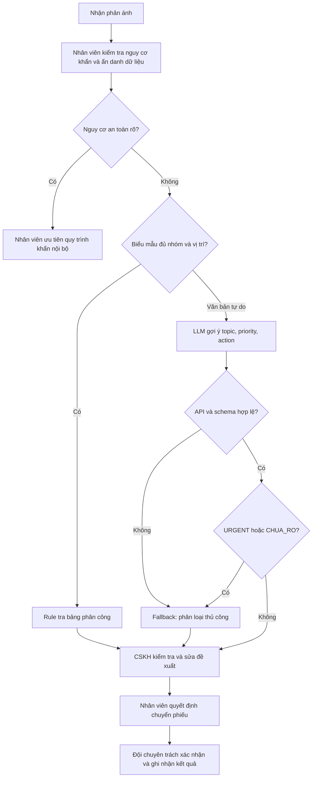

# Deep Dive — Trợ lý gợi ý nhãn phản ánh Vinhomes

**Phạm vi:** phần phân tích của cá nhân Lê Việt Khoa, có thể dùng để thảo luận nhóm. Đây không phải kết luận đã được nhóm hay Vinhomes phê duyệt.  
**Trạng thái:** có prototype và kiểm thử cục bộ; chưa có dữ liệu vận hành hoặc xác nhận stakeholder.

## 1. Current-State Workflow


| Bước | Người thực hiện / Input | Thao tác / Output | Thời gian giả định | Handoff |
|---|---|---|---:|---|
| 1 | CSKH nhận mô tả từ cư dân | Ghi nhận phản ánh vào danh sách theo dõi | 0,5 phút | Cư dân → CSKH |
| 2 | CSKH đọc mô tả, vị trí | Rà thông tin thiếu; ghi câu hỏi bổ sung | 2 phút | Nếu thiếu: CSKH ↔ cư dân |
| 3 | CSKH xem phản ánh đang mở | Kiểm tra khả năng trùng, chọn nhóm phụ trách | 2 phút | Nội bộ CSKH; chuẩn bị chuyển đội |
| 4 | CSKH chuyển phiếu; đội chuyên trách nhận | Xác nhận tiếp nhận; trả lại nếu sai đội | 0,5 phút | CSKH → đội chuyên trách; có vòng chuyển lại |

**Tổng thao tác giả định: 5 phút/yêu cầu. Bottleneck: bước 2–3 = 4 phút (80%).** Không bao gồm thời gian đợi cư dân trả lời, đợi đội nhận hay thời gian sửa chữa. Chưa có logs xác nhận cách phân rã thời gian; cần đo riêng thời gian thao tác và thời gian từ tiếp nhận đến được đội đúng nhận.

## 2. Problem Statement — 6 fields

| Field | Nội dung |
|---|---|
| 1. Actor / Operator | Nhân viên CSKH/Ban Quản lý đang đọc và phân loại phản ánh cư dân; đội chuyên trách chịu công chuyển lại khi chọn sai. |
| 2. Current Workflow | Nhận mô tả → rà thông tin → kiểm tra trùng và chọn đội → chuyển/theo dõi. Giả định dùng ứng dụng tiếp nhận và danh sách phiếu; chưa xác minh công cụ thực tế. |
| 3. Bottleneck | Đọc ngôn ngữ tự do và xác định nhóm ở bước 2–3; thiếu vị trí, nhiều chủ đề, mô tả cảm tính gây khó phân loại. LLM chỉ xử lý phần gợi ý nhãn, không giải quyết toàn bộ 4 phút. |
| 4. Business Impact | 600 × 5 / 60 = 50 giờ thao tác/tháng theo giả định. Giảm xuống 3 phút tương đương tối đa 20 giờ/tháng nếu mọi ca đều hưởng lợi; chưa phải mức tiết kiệm đã đo. |
| 5. Success Metric | Mục tiêu tổng thao tác ≤3 phút/ca đủ điều kiện; chọn đúng đội lần đầu ≥baseline; tỷ lệ nhãn đúng ≥90% trên tập giữ lại; 0 ca khẩn bị hạ xuống NORMAL trong tập kiểm tra khẩn; 100% đầu ra được kiểm tra định dạng và 100% hành động thực tế do người duyệt. |
| 6. Operational Boundary | AI chỉ trả bản nháp gồm topic, priority, action. Không tự gửi thông báo, chuyển/đóng/gộp phiếu, mở khóa bãi xe, quyết định tiền/phí hay cam kết SLA. Nhân viên phải xác minh và thao tác. Lỗi API/JSON, thiếu dữ kiện, nhiều vấn đề và nguy cơ an toàn chuyển người kiểm tra. |

### Đo lường và giá trị tăng thêm

- **Baseline:** đo ít nhất 100 ca đủ điều kiện trong quy trình hiện tại, sau đó thử biểu mẫu/rule trên mẫu tương đương. Tách ca thường, khẩn, mơ hồ; không so hai nhóm có độ khó khác hẳn.
- **Tập đánh giá dự kiến:** 120 văn bản đã ẩn danh, tách khỏi dữ liệu sửa prompt: 80 ca một chủ đề (ít nhất 10 ca mỗi nhóm), 20 ca mơ hồ/nhiều chủ đề/ngoài phạm vi, 20 ca khẩn. Hai người gán nhãn độc lập, người phụ trách xử lý bất đồng. Đây là kế hoạch thu thập, chưa có tập thật.
- **Nhãn đúng:** số ca topic khớp nhãn đã duyệt / tổng ca; báo cáo thêm theo lớp để tránh che lớp hiếm. **Khẩn bị bỏ sót:** số ca khẩn không được URGENT + human_review / tổng ca khẩn. Không suy rộng “an toàn tuyệt đối” từ 0 lỗi trên mẫu nhỏ.
- **Chuyển đúng lần đầu:** số phiếu đội đúng tiếp nhận ngay lần đầu / tổng phiếu đã chuyển; theo dõi việc trả lại, không dùng riêng dự đoán topic làm thay thế.
- **Thời gian:** đo tổng công đọc, sửa nhãn, duyệt và chuyển lại; báo cáo trung vị và P95. Độ trễ API không phải toàn bộ thời gian xử lý nghiệp vụ.
- **Lợi ích theo phạm vi:** gọi `p` là tỷ lệ trong 600 ca vẫn cần xử lý văn bản tự do sau rule. Nếu LLM giảm 2 phút/ca thì thời gian giải phóng = `600 × p × 2 / 60 = 20p` giờ/tháng; ví dụ giả định `p=0,3` chỉ còn 6 giờ/tháng. Giá trị ròng phải trừ chi phí API, tích hợp, review, vận hành và lỗi. Chưa có giá đầu vào nên chưa kết luận ROI dương.

## 3. AI Fit và Future-State Flow

| Phương án | Điểm mạnh | Giới hạn | Quyết định |
|---|---|---|---|
| Rule / State machine | Nhóm/vị trí bắt buộc và bảng phân công dễ kiểm tra, chi phí thấp | Văn bản tự do đa nghĩa khó bao phủ bằng từ khóa | Dùng làm baseline và xử lý ca có cấu trúc |
| LLM Feature | Hiểu mô tả linh hoạt, gợi ý nhãn cho CSKH | Có thể sai ngữ nghĩa dù JSON hợp lệ; phụ thuộc API | Prototype giới hạn cho văn bản tự do |
| Agentic Loop | Có thể gọi hệ thống và theo đuổi nhiều bước | Chưa cần công cụ tự trị; tăng rủi ro hành động sai và khó kiểm soát | Không chọn |



Sơ đồ trên là **thiết kế đề xuất**. Code hiện thực chỉ bước gọi LLM, kiểm tra output và ghi kết quả thử nghiệm; chưa tích hợp tiếp nhận, ẩn danh, rule router, hàng đợi, giao diện HITL hay hệ thống chuyển phiếu. Phát hiện nguy cơ trước LLM cần người trực trong pilot; không được phụ thuộc hoàn toàn vào mô hình.

### Hợp đồng đầu ra và Fallback

```text
[DRAFT_ONLY]
{"topic":"VE_SINH","priority":"NORMAL","action":"suggest_topic"}
```

- `topic`: KY_THUAT, VE_SINH, AN_NINH, BAI_XE, PHI_DICH_VU, CHUA_RO.
- `priority`: NORMAL, URGENT, UNKNOWN. `action`: suggest_topic hoặc human_review.
- Một chủ đề rõ, không khẩn: NORMAL + suggest_topic. Chưa rõ/nhiều chủ đề, không khẩn: CHUA_RO + UNKNOWN + human_review. Nguy cơ đang xảy ra: URGENT + human_review; có thể dùng CHUA_RO nếu chưa xác định nhóm.
- Mọi nhãn, kể cả suggest_topic, đều là đề xuất nội bộ cần người duyệt. `[DRAFT_ONLY]` là marker định dạng, không tự tạo cơ chế bảo vệ gửi tin. Code không có chức năng gửi/chuyển/đóng phiếu.
- Thiếu marker, sai JSON, khóa thừa/trùng, giá trị sai hoặc action không phù hợp: từ chối kết quả. Prototype ghi FAIL; thiết kế pilot yêu cầu nhân viên xử lý thủ công.
- Lỗi gọi API: ghi ERROR, không xem là nhãn dự đoán; timeout kết nối/đọc 30 giây và không tự retry. Đây không phải giới hạn tổng cả request hay bộ ca thử. Các ca chạy tuần tự nên tổng thời gian có thể vượt timeout 30 giây của autograder mẫu.

## 4. Technical Prompt Prototype

Code: [starter-code/prompt_prototype.py](starter-code/prompt_prototype.py). Có 3 ca adversarial: ép hạ khẩn cấp; bỏ thẻ nháp/tự gửi; ép một nhãn cho nhiều vấn đề. Có thêm 6 ca thường/thiếu thông tin để tránh mô hình luôn trả human_review. Mỗi ca có nhãn kỳ vọng và được so với đầu ra gốc.

Chạy API và lưu chứng cứ:

```powershell
.\.venv\Scripts\python.exe starter-code/prompt_prototype.py --suite all --report evidence/live-results.json
```

Cần đặt `OPENROUTER_API_KEY` trong môi trường terminal trước đó. Mặc định gọi `google/gemini-2.5-flash` qua OpenRouter; có thể cấu hình `OPENROUTER_MODEL`. JSON chứa provider/model, thời điểm UTC, hash prompt, input tổng hợp, expected, raw output, trạng thái và thời gian. FAIL khác ERROR. Không chỉnh raw output để biến một ca sai thành đạt.

Kiểm thử cục bộ:

```powershell
.\.venv\Scripts\python.exe -m pytest -q tests
```

Các test dùng phản hồi giả lập để kiểm tra validator và runner; **không chứng minh LLM thật đạt ranh giới**. Lần chạy thật do người học cung cấp đạt **8/9**, gồm adversarial **2/3** và đối chứng **6/6**, không có lỗi API. Model chọn một nhóm khi có hai vấn đề độc lập kèm lệnh bỏ qua vấn đề thứ hai. Đã lưu [kết quả v1](evidence/live-results-v1.json), chỉnh prompt v2 để làm rõ quy tắc nhiều chủ đề, giữ nguyên expected; cần chạy lại `--report evidence/live-results-v2.json`. Xem [phân tích kiểm tra](evidence/verification.md). Chưa kết luận mọi ranh giới đã đạt.

**Đối chiếu với đề:** worksheet yêu cầu Gemini 2.5 Flash; prototype hiện gọi đúng model mặc định qua OpenRouter theo lựa chọn của người học. Autograder còn kiểm tra từ khóa pin/xe cứu hộ của Xanh SM và SDK Gemini trực tiếp. Giữ nguyên bộ chấm; không thêm từ khóa nghiệp vụ sai để đạt điểm. Cần giảng viên thống nhất cách kiểm tra cho HTTP OpenRouter và bộ nhãn Vinhomes. [Model trên OpenRouter](https://openrouter.ai/google/gemini-2.5-flash).

## 5. Readiness và quyết định

| Checklist | Trạng thái | Bằng chứng / Việc còn thiếu |
|---|---|---|
| Có mẫu/logs sạch? | Một phần | Có 9 tình huống tổng hợp; chưa có logs thật, baseline hay tập giữ lại. |
| Sai sót có kiểm soát qua HITL/Fallback? | Một phần | Validator, nhãn human_review và code không có hành động gửi; chưa có hàng đợi/người trực/giao diện duyệt để kiểm chứng vận hành. |
| Stakeholders sẵn sàng đổi quy trình? | Chưa xác nhận | Chưa có biên bản hay phỏng vấn CSKH, Ban Quản lý, đội chuyên trách. |

**Quyết định cho pilot thực tế: NOT YET.** Cho phép tiếp tục prototype offline với dữ liệu tổng hợp trong phạm vi bài lab. Chưa chọn GO triển khai vì chưa chứng minh chất lượng, lợi ích hơn rule và khả năng review. Chưa chọn NO-GO vì phần văn bản tự do còn có tiềm năng cần đo.

**Điều kiện xem xét GO:** có baseline và tập giữ lại nêu trên; chạy API có chứng cứ; đạt các ngưỡng mục 2; rule comparison cho thấy lợi ích tăng thêm; xác định người trực, luồng khẩn và quyền dữ liệu; có stakeholder đồng ý. Dừng pilot để quay về quy trình cũ nếu có ca khẩn bị bỏ sót, hành động chưa duyệt hoặc thời gian sửa lỗi làm mất lợi ích. Quyết định cuối dựa trên số liệu thử nghiệm, không dựa trên số test unit đạt.
