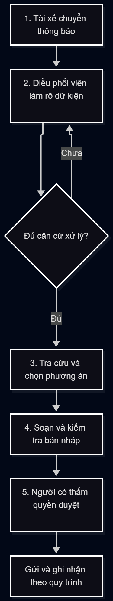

# 🏗️ Phase 3 — DEEP-DIVE (Nhóm, 85 min)

## 3.1. Current-State Workflow Mapping (25 min)

## 3.2. Problem Statement (6-field) & Metrics (15 min)
Điền đầy đủ 6 trường thông tin của bài toán:

| Field | Nội dung chi tiết |
|---|---|
| **1. Actor / Operator** | Nhân viên CSKH, lễ tân, ban quản lí|
| **2. Current Workflow** | Cư dân gửi phản ảnh qua app, nhân viên quản lí sẽ đọc từng khiếu nại và xác định sự cố, mức độ nghiêm trọng tại toà nhà nào, khiếu nại xác định xong sẽ chuyển cho đội quản lý lĩnh vực đó tiếp nhận và giải quyết vấn đề. |
| **3. Bottleneck** | Nhân viên xác định sự cố, mức độ nghiêm trọng từ khiếu nại |
| **4. Business Impact** |   |
| **5. Success Metric** | Giờ công CSKH cho việc phân luồng /tháng	Giảm ≥ 60%; tỉ lệ sự cố khẩn được tiếp nhận đúng phòng	≥ 95%; Điểm hài lòng (CSAT) sau xử lý, số khiếu nại lặp lại cùng vấn đề sẽ tăng / giảm so với baseline |
| **6. Operational Boundary** | Không được tự đóng ticket hoặc đóng ticket chưa xong |

## 3.3. Future-State Flow & AI Fit (25 min)
* **Xác định mức AI Fit (AI-Fit Matrix):** Giải pháp thuộc nhóm nào? [X] Rule / State-Machine [X] LLM Feature [ ] Agentic Loop.
* **Vẽ Future-State Flow:** Đánh dấu rõ:
  * 🔵 **AI Step:** Tác vụ LLM xử lý.
  * 🟢 **Human Step (HITL):** Bước con người phê duyệt/review (Human-in-the-loop).
  * ↩️ **Fallback:** Kế hoạch dự phòng khi LLM trả về kết quả lỗi hoặc không tự tin.
# 🏁 Phase 5 — EVALUATE (Nhóm, 20 min)

### AI Readiness Checklist:
1. [ ] Chúng tôi có sẵn dữ liệu mẫu/logs sạch để test?
2. [X] Rủi ro khi AI sai có nằm trong tầm kiểm soát (qua HITL hoặc Fallback)?
3. [ ] Stakeholders sẵn sàng thay đổi quy trình làm việc cũ?

### Quyết định cuối cùng của Ban Giám Đốc Vin Smart Future:
[ ] **GO (Bắt đầu xây dựng Prototype):** Bắt đầu phát triển với scope hẹp.
[X] **NOT YET (Cần tích lũy thêm dữ liệu/xác lập baseline):** Trì hoãn để chuẩn bị thêm.
[ ] **NO-GO (Không khả thi / Rule-based tốt hơn):** Hủy bỏ dự án AI này.

**Justification (Lý giải quyết định dựa trên bằng chứng kỹ thuật và chi phí):**
> *Bài toán có tiềm năng vì phân loại các khiếu nại cùng chủ đề,LLM rất hữu dụng trong việc chuyển đổi giữa hình ảnh sang text. Tuy nhiên, lí do chính để trạng thái NOT YET được chọn là tập dữ liệu chưa được xác nhận là có lịch sử sạch, đã ẩn danh và được đánh giá. Để lên được GO thì cần xác nhận quyền quyền truy cập và chất lượng của dữ liệu đã ẩn danh, đo baseline theo từng nhóm lỗi khiếu nại gồm gồm thời gian tiếp nhận và phân loại, tỷ lệ chuyển sai và tỷ lệ khiếu nại khẩn bị bỏ sót.*