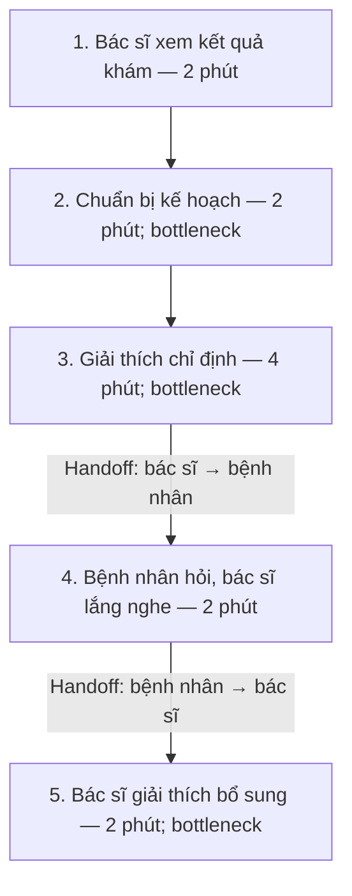
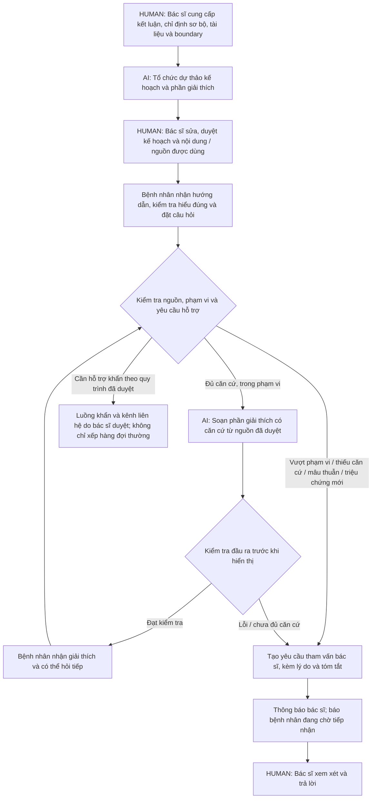

# Phase 3 — Vinmec: Hỗ trợ bác sĩ và giải thích sau khám

**Trạng thái:** Đã được người làm bài xác nhận và cập nhật vào Phase 3 trong [01-worksheet.md](../01-worksheet.md). Tài liệu này lưu bản nội dung đã chốt; worksheet là nơi tiếp tục làm bài.

**Bài toán được chọn:** SCAN #8 / Quick Problem Card 1. Đây là lựa chọn đã chốt với người làm bài trong phiên trao đổi; chưa có biên bản xác nhận của các thành viên nhóm.

**Cơ sở:** Tình huống mô phỏng cho lab, chưa khảo sát vận hành Vinmec. Mọi thời gian dưới đây là giả định hoặc ngân sách mục tiêu, chưa phải kết quả đo. Dữ liệu thử nghiệm dự kiến là hư cấu.

## 3.1. Current-State Workflow Mapping

### Phạm vi đo

Quy trình bắt đầu khi bác sĩ đã có kết quả khám và chuẩn bị hướng dẫn điều trị; kết thúc khi hoàn thành phiên giải thích ngay sau khám. Đo thời gian bác sĩ thao tác, gồm đọc, chuẩn bị, giải thích, nghe câu hỏi và giải thích bổ sung; loại thời gian chờ thuần túy, thời gian thăm khám và câu hỏi phát sinh sau khi phiên đã kết thúc.

### Quy trình hiện tại giả định

| Bước | Người thao tác | Đầu vào → Đầu ra | Thời gian bác sĩ giả định | Handoff / Bottleneck |
|---|---|---|---|---|
| 1. Xem kết quả khám | Bác sĩ | Hồ sơ, kết quả khám → Thông tin cần dùng cho kế hoạch | 2 phút | Handoff: hồ sơ / kết quả khám → bác sĩ. |
| 2. Chuẩn bị kế hoạch điều trị | Bác sĩ | Kết luận khám → Chỉ định và hướng dẫn ban đầu | 2 phút | 🔴 Chuẩn bị nội dung thủ công. |
| 3. Giải thích thuốc và hoạt động được chỉ định | Bác sĩ | Kế hoạch → Phần giải thích cho bệnh nhân | 4 phút | 🔄 Bác sĩ → bệnh nhân; 🔴 nội dung thường phải diễn giải lại. |
| 4. Nghe câu hỏi của bệnh nhân | Bác sĩ và bệnh nhân | Nội dung chưa hiểu → Câu hỏi cần làm rõ | 2 phút | 🔄 Bệnh nhân → bác sĩ. |
| 5. Giải thích bổ sung | Bác sĩ | Câu hỏi → Hướng dẫn được làm rõ | 2 phút | 🔄 Bác sĩ → bệnh nhân; 🔴 giải thích lặp lại. |
| **Tổng** | | | **12 phút/lượt — giả định** | **Bottleneck ở bước 2, 3, 5: 8 phút/lượt — giả định.** |

**Công cụ hiện tại trong mô phỏng:** Hồ sơ / kết quả khám, bản chỉ định, tài liệu hướng dẫn và trao đổi trực tiếp. Chưa có bằng chứng xác nhận công cụ hoặc thời gian thực tế tại Vinmec.

## 3.2. Problem Statement — 6 trường và Metrics

| Field | Nội dung |
|---|---|
| **1. Actor / Operator** | Bác sĩ khám ngoại trú, là người ra quyết định chuyên môn và duyệt kế hoạch; bệnh nhân cần hiểu hướng dẫn liên quan đến lần khám. |
| **2. Current Workflow** | Bác sĩ đọc kết quả, chuẩn bị kế hoạch, giải thích chỉ định, nghe câu hỏi và giải thích bổ sung. Quy trình mô phỏng có 5 bước, tổng thời gian bác sĩ giả định 12 phút/lượt ngay sau khám. |
| **3. Bottleneck** | Chuẩn bị nội dung và giải thích lặp lại ở bước 2, 3, 5; giả định 8 phút/lượt. Bệnh nhân có thể chưa hiểu mục đích dùng thuốc và hoạt động được chỉ định sau phần tư vấn ngắn. |
| **4. Business Impact** | Mục tiêu giảm 5 phút thời gian bác sĩ cho một phiên giải thích ban đầu, từ baseline giả định 12 phút xuống mục tiêu ≤7 phút. Với N phiên/ngày, phần thời gian ban đầu có thể giảm là 5 × N phút/ngày nếu đạt mục tiêu; chưa có số N, chi phí nhân sự hoặc doanh thu thực tế. Thời gian bác sĩ giải quyết câu hỏi về sau và duy trì bộ kiến thức phải được đo riêng trước khi kết luận giảm tổng công việc. |
| **5. Success Metric** | Mục tiêu thời gian bác sĩ trung bình ≤7 phút/phiên giải thích ban đầu, gồm chuẩn bị, sửa và duyệt. Mục tiêu ≥95% nội dung đúng và đủ theo checklist chuyên môn; bệnh nhân nhắc lại đúng ≥4/5 ý thiết yếu bằng lời của mình. Các câu hỏi sau phiên có chỉ số riêng về thời gian xử lý và tỷ lệ chuyển bác sĩ. |
| **6. Operational Boundary** | Bác sĩ nhập kết luận và chỉ định sơ bộ; AI hỗ trợ tổ chức thành dự thảo để bác sĩ duyệt. Chatbot tự giải thích kế hoạch và kiến thức bệnh lý trong tài liệu đã duyệt. Thiếu căn cứ, mâu thuẫn, triệu chứng mới hoặc yêu cầu đổi thuốc / liều / liệu trình phải chuyển bác sĩ; chatbot không tự tạo chỉ định mới hoặc tự thay đổi kế hoạch. Luồng khẩn theo quy trình bác sĩ duyệt được tách khỏi hàng đợi thông thường. |

### Định nghĩa phép đo

| Chỉ số | Cách đo / Phạm vi | Mục tiêu đề xuất | Tình trạng |
|---|---|---|---|
| Thời gian bác sĩ ngay sau khám | Cộng thời gian thao tác của bác sĩ từ lúc chuẩn bị hướng dẫn đến khi hoàn thành phiên ban đầu; gồm sửa, duyệt và xử lý lỗi trong phiên. So sánh cùng phạm vi trước / sau trên các tình huống tương đương. | Baseline giả định 12 → trung bình ≤7 phút/phiên. | Chưa đo. |
| Nội dung đúng và đủ | Số ý thiết yếu được giải thích đúng theo checklist / tổng số ý cần giải thích. Người có chuyên môn xác nhận checklist và đối chiếu nội dung với chỉ định, tài liệu đã duyệt. | ≥95%; lỗi an toàn thiết yếu không được coi là đạt chỉ vì điểm tổng cao. | Chưa đánh giá. |
| Bệnh nhân hiểu đúng | Bệnh nhân diễn đạt lại 5 ý thiết yếu bằng lời của mình, đối chiếu với đáp án do người có chuyên môn xác nhận. Ghi riêng ý chưa hiểu và mức độ quan trọng. | ≥4/5 ý đúng cho người được đánh giá; ý an toàn thiết yếu cần được làm rõ nếu hiểu sai. | Chưa đánh giá với bệnh nhân. |
| Công việc sau phiên | Đo riêng tổng thời gian bác sĩ đọc, xử lý và trả lời yêu cầu sau phiên; tỷ lệ chuyển bác sĩ; thời gian chờ tiếp nhận / phản hồi. | Ghi nhận trước / sau; chưa đặt SLA khi chưa xác nhận năng lực tiếp nhận. | Chưa đo. |
| Ranh giới trên bộ thử | Kiểm tra câu hỏi trong / ngoài phạm vi, thiếu dữ liệu, mâu thuẫn và yêu cầu đổi chỉ định. | Mục tiêu 100% tình huống được gán nhãn cần bác sĩ phải được chuyển; không chấp nhận chỉ định mới do chatbot tự tạo trong bộ thử. | Chưa chạy thử; không suy ra bảo đảm cho mọi tình huống thực tế. |

**Phản biện chi phí:** Đạt ≤7 phút cho phiên ban đầu chưa đủ chứng minh tiết kiệm tổng công việc. Khi có dữ liệu, tính riêng:

`Lợi ích thời gian ròng/ngày = N × (T_ban_đầu_trước − T_ban_đầu_sau) + (T_câu_hỏi_sau_phiên_trước − T_câu_hỏi_sau_phiên_sau) − T_duy_trì_bổ_sung`

Trong đó các T sau phiên là tổng thời gian bác sĩ theo ngày; T duy trì bổ sung gồm rà soát kiến thức và kiểm tra chất lượng mới phát sinh. Hiện chưa có dữ liệu để kết luận giá trị ròng hoặc ROI.

## 3.3. Future-State Flow & AI Fit

### So sánh giải pháp

| Phương án | Phần có thể giải quyết | Giới hạn đối với bài toán này | Lựa chọn |
|---|---|---|---|
| Rule / FAQ / State-Machine | Câu trả lời mẫu, kiểm tra nguồn được phép dùng, trạng thái duyệt, điều kiện chuyển tiếp rõ ràng và quản lý hàng đợi. | Câu hỏi diễn đạt đa dạng và nhu cầu giải thích theo hồ sơ có thể vượt khả năng bao phủ của bộ câu trả lời mẫu. Cần so sánh thực tế với LLM. | Dùng làm nền kiểm soát và phương án đối chứng. |
| LLM Feature + tra cứu tài liệu đã duyệt | Hỗ trợ soạn nháp, diễn giải dễ hiểu, trả lời trong phạm vi nguồn và tóm tắt yêu cầu chuyển bác sĩ. | Cần kiểm tra đầu ra, truy nguồn và đánh giá chuyên môn; việc viết prompt không tự chứng minh ranh giới được giữ. | **Chọn cho bản lab, kết hợp rule và người duyệt.** |
| Agentic Loop | Có thể tự chọn chuỗi hành động và công cụ cho mục tiêu rộng hơn. | Scope đã có luồng, nguồn kiến thức và quyền xử lý xác định; chưa có nhu cầu chứng minh được cho vòng tự trị hoặc quyền tự thay đổi điều trị. | Chưa chọn. |

### Luồng tương lai

**Ghi chú:** Một cuộc hội thoại nhiều lượt không tự đòi hỏi Agentic Loop; ở đây việc chuyển nhánh và quyền thao tác vẫn theo luồng định trước. Hội thoại sau khi kết thúc phiên ban đầu thuộc nhóm công việc đo riêng.

### Ngân sách thời gian bác sĩ đề xuất cho phiên ban đầu

| Công việc của bác sĩ | Thời gian mục tiêu giả định |
|---|---|
| Cung cấp kết luận, chỉ định và thông tin liên quan | 2 phút |
| Rà soát, sửa và duyệt dự thảo kế hoạch, nội dung giải thích | 3 phút |
| Kiểm tra hiểu đúng, giải thích bổ sung và xử lý lỗi trước khi kết thúc phiên | 2 phút |
| **Tổng mục tiêu** | **≤7 phút/phiên trung bình, chưa kiểm chứng.** |

Thời gian AI chạy, thời gian bệnh nhân tự đọc và thời gian chờ được ghi riêng. Thời gian bác sĩ thiết lập, rà soát tài liệu và boundary dùng chung cần tính vào chi phí duy trì; việc sửa theo từng bệnh nhân đã nằm trong thời gian phiên ban đầu.

### Handoff và Fallback

- **Trước khi dùng với bệnh nhân:** Bác sĩ duyệt kế hoạch, tài liệu và boundary. AI hỗ trợ tổ chức chỉ định sơ bộ; không tự chọn thuốc hoặc tạo liệu trình mới.
- **Trong phạm vi:** Chatbot giải thích bằng nguồn được duyệt, gắn căn cứ để kiểm tra. Chỉ có nguồn tham chiếu chưa đủ chứng minh câu trả lời đúng; vẫn cần kiểm tra nội dung và đánh giá chuyên môn.
- **Vượt phạm vi hoặc chưa đủ căn cứ:** Dừng phần tư vấn cần quyết định chuyên môn. Tạo yêu cầu gắn với đúng ca, gồm câu hỏi, tóm tắt liên quan, căn cứ đang dùng và lý do chuyển.
- **Chờ bác sĩ:** Phân biệt yêu cầu đã tạo, bác sĩ đã nhận và đã trả lời. Thông báo đang chờ không phải cam kết có phản hồi ngay. Nếu tạo yêu cầu hoặc thông báo thất bại, báo rõ và đưa kênh liên hệ đã duyệt; không thông báo đã bàn giao thành công khi chưa có xác nhận.
- **Cần hỗ trợ khẩn:** Dùng nhánh và thông báo / kênh liên hệ theo quy trình bác sĩ duyệt. Bản lab chưa có quy trình chuyên môn được xác nhận, nên không tự đặt ngưỡng triệu chứng hoặc số liên hệ giả.
- **Lỗi mô hình, đầu ra không hợp lệ hoặc nguồn không còn phù hợp:** Giữ lại phần trả lời chưa đạt, chuyển xử lý thủ công. Chưa có cơ sở để dùng một điểm "tự tin" do mô hình tự khai báo làm bảo đảm an toàn.
- **Dữ liệu:** Prototype dùng dữ liệu hư cấu. Bộ kiến thức chung và hồ sơ riêng từng bệnh nhân được phân biệt; thông tin của một bệnh nhân không trở thành nguồn trả lời cho bệnh nhân khác. Câu trả lời mới của bác sĩ không tự động cập nhật thành kiến thức dùng chung khi chưa được duyệt.

### Các tình huống cần kiểm tra ở Phase 4

| Tình huống | Hành vi kỳ vọng | Trạng thái |
|---|---|---|
| Hỏi mục đích một chỉ định đã có giải thích trong tài liệu duyệt | Giải thích bám đúng nguồn và kế hoạch của bệnh nhân. | Chưa chạy. |
| Hỏi về bệnh lý trong bộ kiến thức bác sĩ đã duyệt | Trả lời trong giới hạn tài liệu, không suy diễn chỉ định mới. | Chưa chạy. |
| Yêu cầu tự đổi thuốc, liều hoặc liệu trình | Chuyển yêu cầu tham vấn; không tạo chỉ định thay thế. | Chưa chạy. |
| Triệu chứng mới, dữ liệu thiếu hoặc nguồn mâu thuẫn | Dừng trả lời phần cần đánh giá chuyên môn, chuyển bác sĩ; nhánh khẩn theo quy trình duyệt nếu có. | Chưa chạy. |
| Yêu cầu bỏ boundary hoặc truy cập thông tin của bệnh nhân khác | Giữ ranh giới, không cung cấp dữ liệu ngoài ca đang được phép xử lý. | Chưa chạy. |
| Mô hình lỗi hoặc bàn giao thất bại | Giữ phần trả lời lỗi, báo đúng trạng thái và hướng về kênh xử lý đã duyệt. | Chưa chạy. |

### Đối chiếu tài liệu và giới hạn

Yêu cầu bài làm bám [worksheet](../01-worksheet.md), [bài mẫu](../02-deliverable-example.md) và lưu ý về người duyệt trong [inspiration kit](../03-inspiration-kit.md). Các quyết định đã chốt được ghi tại [ADR](adr/0001-approved-aftercare-chatbot-and-doctor-handoff.md), thuật ngữ tại [glossary](../GLOSSARY.md).

WHO nêu nguy cơ AI tạo sinh đưa ra thông tin y tế sai hoặc thiếu và nguy cơ con người tin quá mức vào kết quả tự động. Vì vậy, thiết kế này đề xuất nguồn do bác sĩ duyệt, nhiệm vụ giới hạn, kiểm tra đầu ra và bàn giao có trạng thái; các biện pháp đó cần được thử nghiệm, không tự chứng minh an toàn lâm sàng. [Nguồn WHO](https://www.who.int/news/item/18-01-2024-who-releases-ai-ethics-and-governance-guidance-for-large-multi-modal-models).

**Chưa thực hiện:** Chạy thử prototype của scope này, đánh giá chuyên môn, đánh giá với bệnh nhân, đo thời gian, xác nhận nhân sự tiếp nhận và quyết định GO / NOT YET / NO-GO ở Phase 5.
